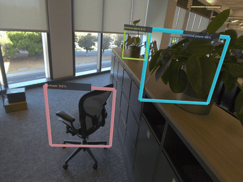

# SpatialML Samples

Native Android/OpenXR samples for PICO SpatialML. The repository demonstrates camera access, LiteRT inference, tensor processing, readback, glTF rendering, and JSON-defined pipeline packages on PICO Space Pro.

## Sample gallery

| Face tracking | Pose estimation | Object detection |
|:-------------:|:---------------:|:----------------:|
|  |  |  |
| **MNIST Wild** | **Rubik's Cube** | **Whack-a-Mole** |
|  |  |  |
| **Stylize** | **MediaPipe Face Pipeline** | |
|  |  | |

## Active Gradle modules

The modules below are included by [`settings.gradle`](settings.gradle). Five demos have both a programmatic C++ implementation and a loader-driven schema-v2 package implementation.

| Demo | Programmatic module | Pipeline-package module | Model target |
|------|---------------------|-------------------------|--------------|
| Face tracking (UFO) | `:samples:ufo` | — | LiteRT NPU |
| Face detection overlay | — | `:samples:face_mediapipe_pipeline` | LiteRT NPU |
| Pose estimation | `:samples:pose` | `:samples:pose_pipeline` | LiteRT NPU |
| YOLO object detection | `:samples:yolo_det` | `:samples:yolo_det_pipeline` | LiteRT NPU |
| MNIST recognition | `:samples:mnistwild` | `:samples:mnistwild_pipeline` | LiteRT NPU |
| Whack-a-Mole | `:samples:whackamole` | `:samples:whackamole_pipeline` | LiteRT NPU |
| Stylization | `:samples:stylize` | `:samples:stylize_pipeline` | LiteRT NPU |
| Tensor readback | `:samples:readback` | — | No model |
| Rubik's Cube | `:samples:rubics_cube` | — | No model |

`samples/model_inspect` and `samples/ufo_origin` remain in the tree as legacy/reference utilities but are not included in the current Gradle project.

## Programmatic and package-based samples

- Programmatic modules construct SpatialML tensors and operators in C++. Their shared assets live under [`assets/`](assets).
- Pipeline modules load a complete package from their own `src/main/assets/<package>/` directory with `SecureMrUtils::LoadModelPackagePipelinesFromAssets(...)`. Each package contains a schema-v2 `manifest.json`, pipeline JSON, TFLite models, and glTF resources.
- [`samples/pipeline_common`](samples/pipeline_common/README.md) provides the common host used by the straightforward package variants. Whack-a-Mole and Stylize use sample-specific hosts because they require additional runtime state and controller interaction.

All currently active ML samples select the LiteRT NPU target. A successful app launch should show LiteRT Qualcomm compiler/dispatch initialization followed by repeated `OpenMR: executePipeline ... err: 0` messages.

## Models

| Demo | Model family | Source |
|------|--------------|--------|
| UFO and Face Pipeline | MediaPipe Face Detection | [Qualcomm AI Hub](https://aihub.qualcomm.com/models/mediapipe_face) |
| Pose and Whack-a-Mole | MediaPipe Pose Detector and Pose Landmarker | [Google AI Edge](https://ai.google.dev/edge/mediapipe/solutions/vision/pose_landmarker#models) |
| YOLO | YOLOX-M | [LiteRT Community](https://huggingface.co/litert-community/yolox-m-litert) |
| MNIST Wild | MNIST-12 converted to TFLite | [ONNX Model Zoo](https://github.com/onnx/models/tree/main/validated/vision/classification/mnist) |
| Stylize | Arbitrary Image Stylization v1 | [Kaggle Models](https://www.kaggle.com/models/google/arbitrary-image-stylization-v1/tfLite) |

## Requirements

- PICO Space Pro with SpatialML support
- Android SDK 34
- Android NDK `26.3.11579264` (r26d)
- Java 17 or newer
- Repository submodules initialized, including `external/SpatialML-XR-Utils`

This checkout pins Gradle 8.7, Android Gradle Plugin 8.3.2, and Kotlin 1.9.24.

```sh
git submodule update --init --recursive
```

## Build and run

Build one module from the repository root. For example:

```sh
./gradlew :samples:face_mediapipe_pipeline:assembleDebug
./gradlew :samples:pose_pipeline:assembleDebug
./gradlew :samples:yolo_det:assembleDebug
./gradlew :samples:yolo_det_pipeline:assembleDebug
```

Install directly by replacing `assembleDebug` with `installDebug`, or install the generated APK explicitly. When more than one device is attached, always pass its serial:

```sh
adb -s <device-serial> install -r samples/face_mediapipe_pipeline/build/outputs/apk/debug/face_mediapipe_pipeline-debug.apk
```

Launch the app from the headset launcher and grant camera permission when prompted. Enable detailed SpatialML/OpenMR logs when diagnosing startup or inference:

```sh
adb -s <device-serial> shell setprop debug.pico.securemr.debug 1
adb -s <device-serial> logcat | grep -E 'OpenMR|Secure MR|litert|SpatialMLDebug'
```

## Pipeline packages

The active package samples bundle their assets in Git, so normal Gradle builds do not download models. For example the Face package is also published in the [PICO SpatialML Pipeline Zoo](https://huggingface.co/collections/picoxr/spatialml-pipeline-zoo), but this repository builds from [`samples/face_mediapipe_pipeline/src/main/assets/xr-face-mediapipe-pipeline`](samples/face_mediapipe_pipeline/src/main/assets/xr-face-mediapipe-pipeline).

## Repository layout

```text
.
├── assets/                        shared assets for programmatic samples
├── external/SpatialML-XR-Utils/   shared OpenXR and SpatialML utilities
├── samples/
│   ├── ufo/                       programmatic face tracking
│   ├── face_mediapipe_pipeline/   package-driven face detection overlay
│   ├── mnistwild/
│   │   ├── programmatic/          programmatic digit recognition
│   │   └── pipeline/              package-driven digit recognition
│   ├── pose/
│   │   ├── programmatic/          programmatic pose estimation
│   │   └── pipeline/              package-driven pose estimation
│   ├── yolo_det/
│   │   ├── programmatic/          programmatic object detection
│   │   └── pipeline/              package-driven object detection
│   ├── whackamole/
│   │   ├── programmatic/          programmatic pose-driven game
│   │   └── pipeline/              package-driven pose game
│   ├── stylize/
│   │   ├── programmatic/          programmatic image stylization
│   │   └── pipeline/              package-driven image stylization
│   ├── readback/                  CPU, Vulkan, and OpenGL readback variants
│   ├── rubics_cube/               camera readback and cube solver
│   └── pipeline_common/           shared package-host implementation
└── scripts/                       repository utilities
```

## Additional documentation

- [YOLO programmatic sample](samples/yolo_det/programmatic/README.md)
- [YOLO pipeline-package sample](samples/yolo_det/pipeline/README.md)
- [PICO SpatialML Pipeline Zoo](https://huggingface.co/collections/picoxr/spatialml-pipeline-zoo)
- [PICO developer documentation](https://developer-cn.picoxr.com/document/native/securemr-overview/)
